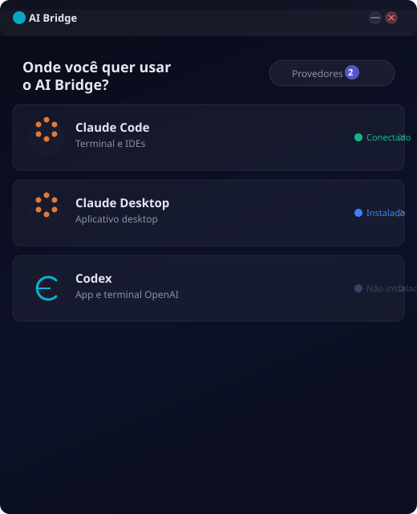
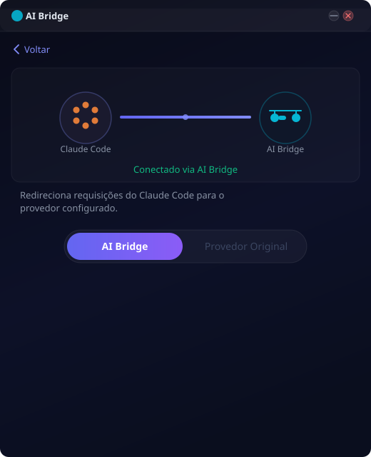
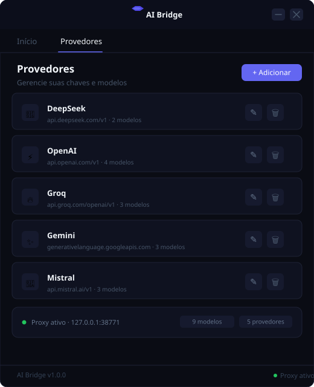

# AI Bridge

Proxy local que traduz a API do Claude (Anthropic) para o formato OpenAI, permitindo usar qualquer provedor compatível diretamente no **Claude Code**, **Claude Desktop** e **Codex**.

<p align="center">
  
</p>

---

## Download

> Baixe o executável direto — sem instalar Python, sem configurar ambiente.

| Plataforma | Download |
|:---:|:---:|
| **Windows** | [⬇ AI-Bridge-Windows.exe](https://github.com/LMPrado-DZ23/ai-bridge/releases/latest/download/AI-Bridge-Windows.exe) |
| **Linux** | [⬇ AI-Bridge-Linux](https://github.com/LMPrado-DZ23/ai-bridge/releases/latest/download/AI-Bridge-Linux) |
| **macOS** | [⬇ AI-Bridge-macOS](https://github.com/LMPrado-DZ23/ai-bridge/releases/latest/download/AI-Bridge-macOS) |

Os binários são gerados automaticamente a cada push no branch `main` via GitHub Actions.

---

## Como funciona

```
Claude Code / Claude Desktop / Codex
         ↓  (Anthropic Messages API)
      AI Bridge  ←→  Provedor OpenAI-compatible
                      (DeepSeek, Groq, OpenRouter…)
```

O AI Bridge sobe um proxy HTTP local. Você aponta o cliente para `http://localhost:<porta>` e ele traduz as chamadas automaticamente — streaming, ferramentas e tudo mais.

---

## Capturas de tela

<p align="center">
  
  &nbsp;&nbsp;
  
</p>
<p align="center">
  
</p>

---

## Destinos suportados

| Destino | O que é configurado |
|---|---|
| **Claude Code** | Variável `ANTHROPIC_BASE_URL` + porta do proxy |
| **Claude Desktop** | `claude_desktop_config.json` → `baseURL` |
| **Codex** | `OPENAI_BASE_URL` → proxy do AI Bridge |

---

## Provedores compatíveis

Qualquer API com endpoint compatível com OpenAI (`/v1/chat/completions`):

- [DeepSeek](https://platform.deepseek.com) — `api.deepseek.com`
- [Groq](https://console.groq.com) — `api.groq.com/openai/v1`
- [OpenRouter](https://openrouter.ai) — `openrouter.ai/api/v1`
- [Ollama](https://ollama.com) (local) — `localhost:11434/v1`
- Qualquer outro endpoint OpenAI-compatible

---

## Compilar a partir do código

**Pré-requisitos:** Python 3.12+, pip

```bash
git clone https://github.com/LMPrado-DZ23/ai-bridge.git
cd ai-bridge
pip install -r requirements.txt
python entry.py
```

**Gerar executável:**

```bash
python -m PyInstaller build.spec --noconfirm
# Saída: dist/AI-Bridge.exe  (Windows)
#        dist/AI-Bridge       (Linux / macOS)
```

---

## CI / CD

O workflow `.github/workflows/build.yml` compila para as 3 plataformas em paralelo e publica automaticamente uma release `latest` com os binários prontos para download.

---

## Licença

MIT
