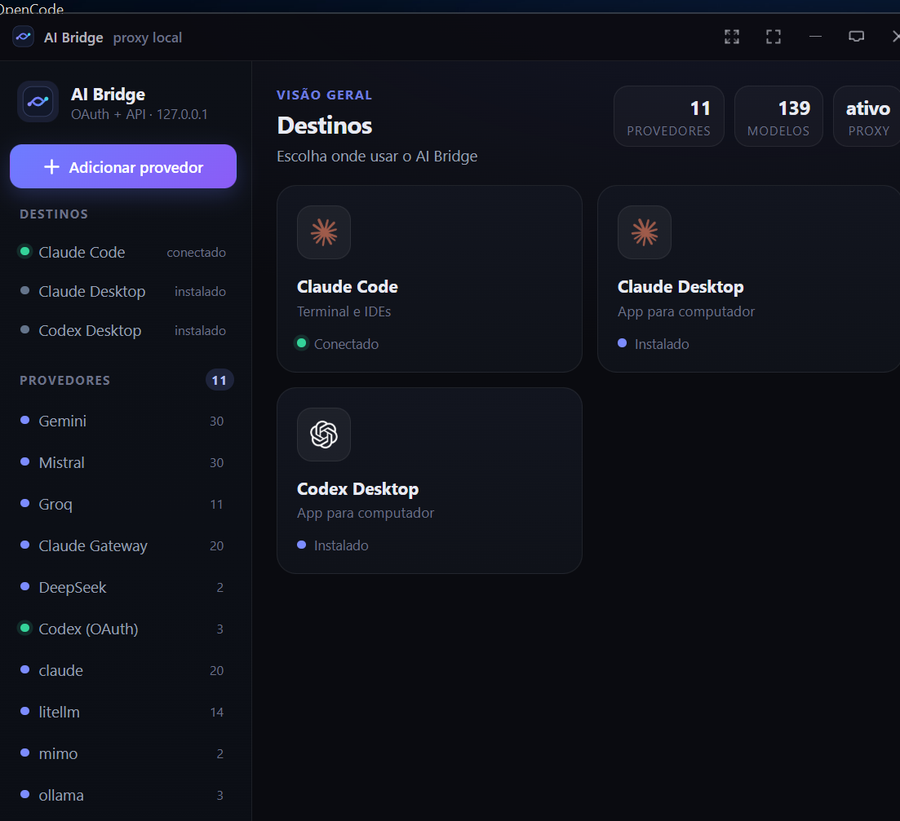
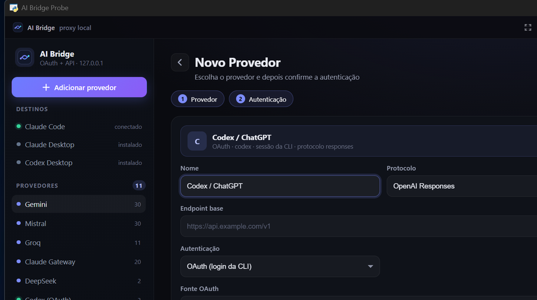

# AI Bridge

> Proxy local que conecta Claude Code, Claude Desktop e Codex Desktop a **qualquer provedor de IA** — por API key, variável de ambiente ou **OAuth reaproveitando o login da CLI**.

[](https://github.com/LMPrado-DZ23/ai-bridge/actions/workflows/ci.yml)
[](https://github.com/LMPrado-DZ23/ai-bridge/actions/workflows/build.yml)

<p align="center">
  
</p>

---

## O que é

**AI Bridge** é um aplicativo desktop (Windows, macOS e Linux) que roda um proxy HTTP em
`127.0.0.1` e fala o protocolo de cada cliente:

```
Claude Code / Claude Desktop ──(Anthropic Messages)──┐
Codex Desktop ───────────────(OpenAI Responses)──────┤──►  AI Bridge  ──►  Provedor
Outros clientes ─────────────(OpenAI Chat)───────────┘    127.0.0.1
```

## Recursos

- **Autenticação em três modos por provedor**
  - API key no keyring do sistema (nunca em arquivo)
  - variável de ambiente (`env_key`, estilo DeepSeek Harness)
  - **OAuth**: reutiliza a sessão de `codex`, `claude`, `gemini`, `gcloud`, `hf`, `wrangler` e `gh`, renova no mesmo endpoint da CLI e grava de volta; se não houver sessão, faz login PKCE com callback local na URL registrada do client
- **Descoberta automática de modelos** (`GET /models`, fallback `/api/tags` do Ollama) com filtro **só gratuitos**
- **Importação do DeepSeek Harness** (`~/.dsh/profiles/<perfil>/cordis.patch.yml`) com atualização dos modelos direto na API
- **Catálogo unificado para o Codex Desktop**: um seletor só, misturando assinaturas OAuth e API keys, com conexão/desconexão reversível
- **Protocolos**: Anthropic Messages, OpenAI Chat Completions e OpenAI Responses, com *passthrough* de SSE sem retradução
- **Interface em dois passos**: escolher provedor → autenticar, com prévia dos modelos e barra fixa de ações; bandeja do sistema e atalhos
- **Testes**: 163 testes offline, sem rede e sem tocar em credenciais reais

<p align="center">
  
</p>

## Download

Binários gerados pelo GitHub Actions a cada push na `main` (release `latest`):

| Plataforma | Arquivo | Requisitos |
|---|---|---|
| **Windows 10/11 (x64) — instalador** | [AI-Bridge-Setup.exe](https://github.com/LMPrado-DZ23/ai-bridge/releases/latest/download/AI-Bridge-Setup.exe) | instala por usuário, atalhos no Menu Iniciar, desinstalador e autostart opcional |
| **Windows 10/11 (x64) — portátil** | [AI-Bridge-Windows.exe](https://github.com/LMPrado-DZ23/ai-bridge/releases/latest/download/AI-Bridge-Windows.exe) | executável portátil; usa o **WebView2** (já presente no Windows 10/11) |
| **Linux (x64)** | [AI-Bridge-Linux](https://github.com/LMPrado-DZ23/ai-bridge/releases/latest/download/AI-Bridge-Linux) | build em Ubuntu 22.04; precisa de **GTK3 + WebKitGTK 4.1** (ex.: `libwebkit2gtk-4.1-0`) |
| **macOS (Apple Silicon)** | [AI-Bridge-macOS](https://github.com/LMPrado-DZ23/ai-bridge/releases/latest/download/AI-Bridge-macOS) | build em `macos-latest` (arm64), **não assinado** — veja abaixo |

> Não são instaladores (`.msi`/`.dmg`/`.deb`) e sim **executáveis portáteis**: baixe, coloque em
> qualquer pasta e execute. No Windows você pode criar um atalho no Menu Iniciar apontando para o `.exe`.

### Observações por sistema

- **Windows**: o `.exe` não é assinado digitalmente, então o SmartScreen pode avisar
  ("Mais informações → Executar assim mesmo"). O ícone de bandeja funciona e a janela fecha
  de verdade ao clicar em X.
- **macOS (Apple Silicon)**: binário sem assinatura/notarização. Na primeira execução use
  **clique com botão direito → Abrir**, ou remova a quarentena:
  `xattr -d com.apple.quarantine AI-Bridge-macOS`. Em Macs **Intel**, compile do código-fonte
  (o binário publicado é arm64).
- **Linux**: se o WebKitGTK 4.1 não estiver instalado:
  `sudo apt install libwebkit2gtk-4.1-0` (Ubuntu/Debian) ou o equivalente da sua distro.
- **Outras arquiteturas** (Windows ARM, Linux ARM): rode do código-fonte.

## Rodar do código-fonte (qualquer SO com Python 3.10+)

```bash
git clone https://github.com/LMPrado-DZ23/ai-bridge.git
cd ai-bridge
python -m venv .venv
.venv\Scripts\pip install -r requirements.txt     # Windows
# source .venv/bin/activate && pip install -r requirements.txt   # macOS/Linux
.venv\Scripts\python entry.py
```

Testes:

```bash
python -m pytest tests -q     # 163 passed
```

## Provedores suportados

**API key / variável de ambiente**: DeepSeek, OpenAI, Anthropic, Google Gemini, Groq, Mistral,
OpenRouter, Together, Ollama (local), Ollama Cloud, Xiaomi MiMo, Moonshot/Kimi, Zhipu GLM,
xAI Grok, LiteLLM Gateway e **qualquer endpoint OpenAI/Anthropic-compatible**.

**OAuth (reaproveita a CLI)**: Codex/ChatGPT, Claude Code, Gemini CLI, gcloud ADC,
Hugging Face, Cloudflare Wrangler e GitHub Copilot.

## Destinos suportados

| Destino | Protocolo | Como conecta |
|---|---|---|
| **Claude Code** | Anthropic | `ANTHROPIC_BASE_URL` + `ANTHROPIC_API_KEY` |
| **Claude Desktop** | gateway 3P | perfil reversível em `%LOCALAPPDATA%\Claude-3p\configLibrary` |
| **Codex Desktop** | OpenAI Responses | provider local + catálogo JSON unificado, alternável em um clique |

## Segurança

- Chaves nunca vão para `~/.ai-bridge/config.json`; ficam no keyring, em variável de ambiente ou no arquivo da própria CLI (OAuth).
- Proxy exclusivamente em `127.0.0.1`.
- A UI recebe apenas booleanos de estado (`has_key`, `connected`), nunca o segredo.
- Login OAuth restrito a loopback, `state` de uso único e servidor encerrado ao final.

## Documentação

- [docs/OAUTH.md](docs/OAUTH.md) — fontes OAuth, refresh, PKCE, limitações e como criar um adaptador.
- [docs/AUDITORIA.md](docs/AUDITORIA.md) — guia para auditoria independente do repositório.
- [docs/PROGRESS.md](docs/PROGRESS.md) — ondas, evidências e critérios de aceite da edição Professional.
- [docs/INSTALL-WINDOWS.md](docs/INSTALL-WINDOWS.md) — instalação, instalador e desinstalação no Windows.
- [docs/COMPATIBILITY.md](docs/COMPATIBILITY.md) — matriz de capacidades por provedor (só anuncia o que foi verificado).

## Estrutura

```
ai_bridge/
├── proxy.py        # rotas Anthropic/OpenAI e passthrough SSE
├── oauth.py        # fontes de credencial (codex, claude, gemini, gcloud, hf, cf, copilot)
├── oauth_login.py  # login PKCE com callback local
├── discovery.py    # descoberta de modelos e marcação de gratuitos
├── dsh_import.py   # importação do perfil do DeepSeek Harness
├── config.py       # provedores, keyring, env_key
├── codex.py        # integração reversível com o Codex Desktop
├── claude_code.py  # env vars do Claude Code
├── claude_desktop.py # perfil do Claude Desktop
├── bridge.py       # API JS↔Python da interface
└── ui/             # index.html, app.css, app.js
tests/              # 163 testes offline
```

## Licença

MIT
